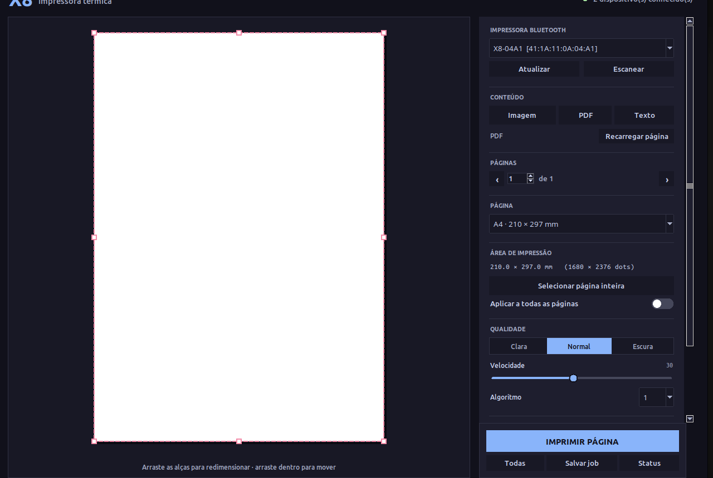
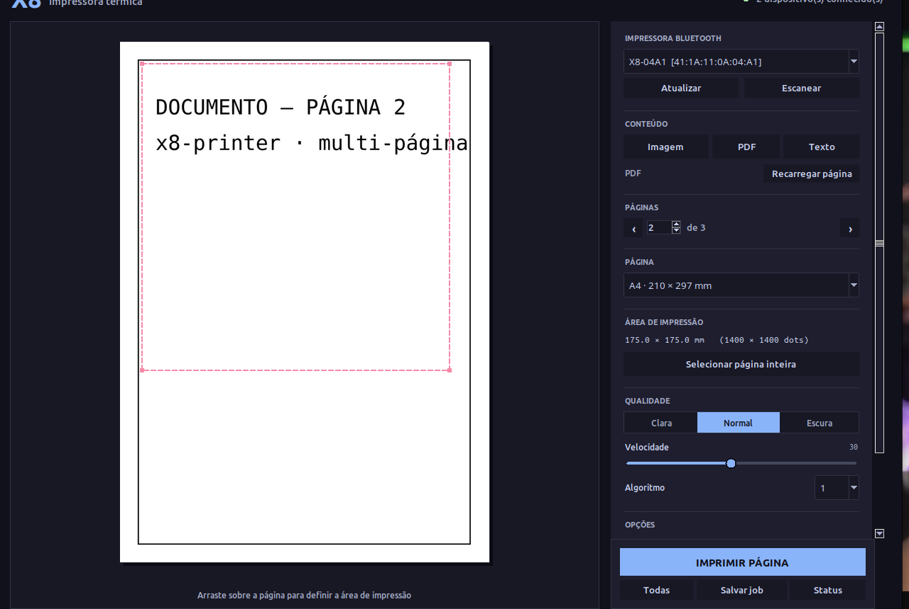
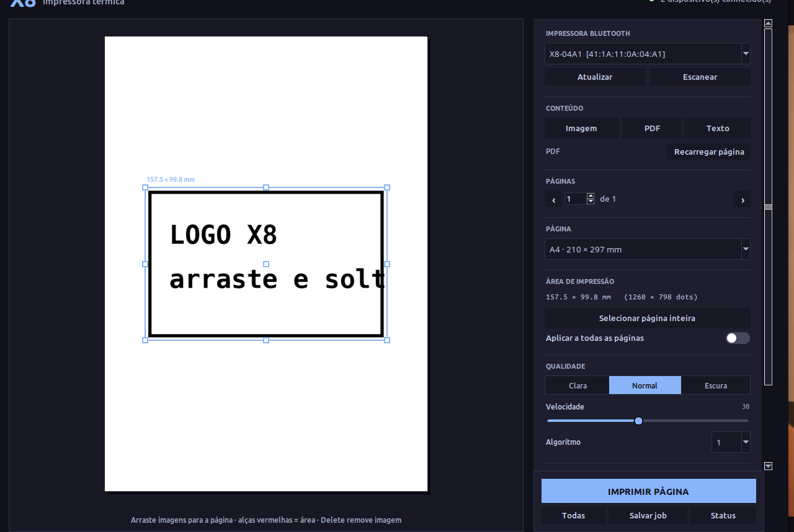

# open-x8-printer

Controle da impressora térmica portátil **Marklife X8** (Bluetooth `X8-04A1`,
`41:1A:11:0A:04:A1`) a partir do Linux, sem o app Android.

O protocolo foi extraído por engenharia reversa do APK oficial
`com.feioou.deliprint.yxq` (Marklife 3.9.x), com JADX.

## Estado

| Item | Situação |
|---|---|
| Protocolo | ✅ mapeado e validado em hardware (`X8Protocol`, id 10) |
| Transporte | ✅ RFCOMM/SPP, canal 3 |
| Codificação JBIG | ✅ via `jbigkit` (`pbmtojbg -q -o 0 -p 0`) |
| Feed preciso | ✅ `paperType=1` avança e para sem ejetar a folha |
| Renderização texto/imagem | ✅ Pillow |

## O aparelho

```
Nome    X8-04A1
MAC     41:1A:11:0A:04:A1
Classe  0x00040680 (impressora)
Perfis  Serial Port (SPP), canais 2 e 3
```

- Papel A4 (210 mm), cabeça de 203 dpi (8 dots/mm)
- Largura útil do modelo: 1600 dots (200 mm); largura de página: 1728
- USB-C é **somente carga** (não enumera como dispositivo)

## Protocolo (X8Protocol, id 10)

```
config   1F FD 01 A5 <param> <valor>
faixa    1F 01 05 A5 <wL wH hL hH lenL lenH> + JBIG
fim      1F 01 06 A5 <01|02>      02 = última cópia
```

- `w`/`h`/`len` em little-endian
- cada faixa tem no máximo **100 linhas**
- cada faixa é uma imagem **JBIG (ITU-T T.82)** independente
- parâmetros de config usados pelo app:

| param | valor | significado (inferido) |
|---|---|---|
| 1 | `0x10` | fixo |
| 2 | 30 | velocidade |
| 3 | 1 | fixo |
| 4 | 2 | fixo |
| 5 | 2 | densidade (1–3) |
| 6 | `0x30` | fixo |
| 8 | 1 | tipo de página (1 normal, 2 imagem, 3 scan, 4 web, 5 tatuagem) |
| 9 | 1 | algoritmo (1 padrão, 2 imagem) |
| 10 | 2 | papel (1 imagem/rolo, 2 documento, 3 tatuagem) |

Descoberta importante: **não existe comando de feed isolado** no X8. O papel só
avança durante um job de bitmap; por isso "imprimir uma faixa em branco" é a
forma correta de puxar N mm.

### Feed preciso vs. ejeção da folha

O parâmetro 10 (`paperType`) muda o comportamento no fim do job:

| Valor | Modo | Comportamento |
|---|---|---|
| 1 | contínuo / rolo | avança o conteúdo e **para**, deixando a folha presa |
| 2 | documento | imprime e **ejeta a folha inteira** |
| 3 | tatuagem | papel de tatuagem |

O comando `x8 feed` usa `paperType=1` por padrão justamente para permitir
avanços parciais (ex.: 100 mm). Já `x8 text`/`x8 image` usam `paperType=2`
para ejetar a página.

O terminador também importa: `1F 01 06 A5 02` = última página,
`... 01` = página não final (`--no-eject`).

## Instalação

```bash
sudo apt install jbigkit-bin
python3 -m pip install --user --break-system-packages -e .
```

O `tkinterdnd2` (arrastar-e-soltar) é instalado junto. Sem ele, a interface
continua funcionando, apenas sem drag-and-drop.

## Interface desktop

```bash
./x8-gui.sh
# ou, sem instalar (da raiz do projeto):
python3 -m src.gui
```


Recursos:

- **Seletor de impressora Bluetooth** no topo: lista os dispositivos
  conhecidos (impressoras primeiro), com **Atualizar** e **Escanear** (8 s)
- Tema escuro moderno, slider desenhado e barra **IMPRIMIR** fixa no rodapé
- **Arraste imagens do sistema de arquivos para a página** (drag-and-drop):
  a imagem vira um objeto que pode ser **movido** e **redimensionado**;
  **Delete** remove a imagem selecionada
- A imagem colocada é independente da área de impressão vermelha — uma pode
  ser ajustada sem mexer na outra
- **Área de impressão fixa** em cada página, com **alças** para
  redimensionar e arraste interno para mover
- Cada página pode ter **sua própria área**; o switch **Aplicar a todas as
  páginas** replica a área atual para o documento inteiro
- **Múltiplas páginas**: abra várias imagens de uma vez ou um PDF completo;
  navegue com **‹ ›** e o campo de página; **Todas** imprime a sequência
- Página **A4, A5 ou Letter** em escala real (203 dpi)
- O painel mostra as dimensões da área em mm e dots
- “Selecionar página inteira” para resetar a área
- Densidade **Clara / Normal / Escura** e velocidade, como no app
- Abrir **imagem** (uma ou várias), **PDF completo** ou digitar **texto**
- “Manter posição na folha” preserva o lugar do recorte (preenche o resto com
  branco) ou desmarque para imprimir só o recorte no topo
- “Ejetar a folha” usa `paperType=2`; desmarcado usa modo contínuo
- **Avançar papel** em mm e **Status** (bateria/papel/tampa)
- **Salvar job (.bin)** sem enviar

Validação offline: o job gerado pela interface foi decodificado de volta
(JBIG → PBM) e comparado com o raster esperado — 101.500 bytes idênticos.

### Demonstração

| Área de impressão fixa e redimensionável | Múltiplas páginas |
|---|---|
|  |  |

Imagem arrastada para a página, com alças de mover/redimensionar:



## Uso

```bash
# avança 100 mm em branco
x8 feed 100

# imprime texto
x8 text "Ola, mundo!"

# imprime uma imagem
x8 image foto.png

# só gera o job, sem enviar
x8 --dry-run --save job.bin feed 100

# ignora a descoberta automática de canal
x8 --channel 3 feed 50
```

O MAC pode ser trocado com `--mac` ou pela variável `X8_MAC`.

## Antes de imprimir

1. A impressora precisa estar **ligada** (LED azul fixo).
2. Esteja pareada e com o Bluetooth do PC ligado.
3. **Desconecte o celular** — muitas dessas impressoras aceitam uma sessão SPP
   por vez; com o app aberto, os bytes vão para o telefone.
4. Não deixe o auto-off de 30 min desligá-la no meio do job.

## Firmware oficial

O app consulta `POST http://m.yinxiaoqian.com/beekeyjiang/commons/getHardVersion`
com `{"deviceName":"X8","supplierName":"自研","firewareVersion":"..."}`.

Resposta para o X8:

```json
{"versionNum":"1.0.14",
 "url":"https://resource.yinxiaoqian.com/upload_file_1792043801280_X8_OTA_V1.0.14.fot"}
```

O arquivo está em `firmware/X8_OTA_V1.0.14.fot` (463.872 bytes).

Formato: container **FOT** da Bluetrum, codename de chip **SMAT**
(família AB563x / BT892x). O cabeçalho é texto claro (`FOT`, `SMAT`,
timestamp, tamanho), mas o payload tem entropia 8,0 — é cifrado com a
*code key* gravada no EFUSE do chip.

Consequências:

- `fwunpack.py` do projeto bluetrum-tools **não** abre esse container de OTA
  (ele espera um dump de flash, não um `.fot`).
- Para decifrar seria preciso ler a code key pelo **bootloader UART** do chip
  (pinos PB3/PA7, adaptador 3.3 V), o que exige abrir a impressora.
- O USB-C é só carga, então não há caminho de dados por cabo.
- Mesmo decifrado, regravar exigiria o bootloader UART; o OTA por Bluetooth só
  aceita o pacote cifrado da fabricante.

Resumo: o `.fot` serve para **restaurar/atualizar** o firmware oficial pelo app,
não para adicionar recursos.

## Limitações conhecidas

- **Sem retrocesso de papel.** O modelo declara `backPaperNum = 0` e o app
  nunca envia ré no X8. Testamos `10 FF F2` (backoff do L11),
  `1F 11 51 00 00` (retorno do A50), `1B 6A 08` (reverse feed ESC/POS) e o
  parâmetro 7 da config — nenhum recuou o papel; o parâmetro 7 fez o firmware
  ignorar o job. Para tirar papel, puxe a folha manualmente.
- **Ejeção da folha.** Com `paperType=2` (documento) a página inteira é
  ejetada ao fim do job. Para avanço parcial use `paperType=1` (`x8 feed`).
- **USB-C é só carga**, não enumera como dispositivo.

## Testes

```bash
python3 -m unittest discover -s tests -v
# ou
python3 -m pytest
```

## Estrutura

```
open-x8-printer/
├── src/
│   ├── __init__.py
│   ├── protocol.py   pacotes de config/faixa/fim
│   ├── jbig.py       encoder JBIG via jbigkit
│   ├── render.py     texto/imagem -> raster 1-bit
│   ├── transport.py  RFCOMM com fallback de canal
│   ├── cli.py        comandos feed/text/image/raw/status
│   └── gui.py        interface desktop (Tkinter)
├── tests/            testes de protocolo e renderização
├── docs/             capturas e demonstrações
├── scripts/          experimentos da engenharia reversa
├── x8.sh             atalho da CLI
├── x8-gui.sh         atalho da interface
└── pyproject.toml
```

`firmware/`, `sdk/`, APK e fontes decompiladas de terceiros ficam **fora do
Git** (veja `.gitignore`).

## Build e releases

O workflow [`.github/workflows/build.yml`](.github/workflows/build.yml):

- **Tag `v*`** → compila e publica no **Release**:
  - `open-x8-printer.exe` (Windows, onefile)
  - `open-x8-printer-x86_64.AppImage` (Linux)
- **workflow_dispatch** → gera os dois artefatos sem publicar release

O `pbmtojbg` (jbigkit 2.1) é compilado estaticamente no CI e embutido no
pacote; o app o encontra ao lado do executável automaticamente.

Build local (Linux, sem AppImage):

```bash
python3 -m venv .venv && . .venv/bin/activate
pip install . pyinstaller
pyinstaller --noconfirm --windowed --onedir --name open-x8-printer \
  --add-binary "vendor/pbmtojbg:." --collect-all tkinterdnd2 \
  --paths . packaging/entry.py
```

## Aviso

Projeto independente, sem vínculo com a Marklife. O protocolo foi obtido por
análise do app oficial; use por sua conta e risco. Um job malformado pode
travar o firmware (aconteceu durante os testes) — o reset é por corte de
energia/bateria.
